<div align="center">

  <h1>Bukaake</h1>

  <p>
    <strong>The ultra-fast, transparent, and distraction-free photo viewer for Windows.</strong><br />
    <em>Reviving the desktop-immersive magic of the classic Google Picasa Photo Viewer with modern stroke-free frosted glass.</em>
  </p>

  <p>
    <a href="https://github.com/Crlyzd/Bukaake/releases/latest"></a>
    <a href="https://bukaake.kaleksananbagus.com"></a>
    <a href="https://github.com/Crlyzd/Bukaake/releases"></a>
    <a href="https://github.com/Crlyzd/Bukaake/releases"></a>
    <a href="https://apps.microsoft.com/detail/9N964R72X9JS"></a>
    <a href="https://github.com/Crlyzd/Bukaake/releases"></a>
    <a href="LICENSE"></a>
  </p>

  <p>
    <a href="https://apps.microsoft.com/detail/9N964R72X9JS"></a>
    <a href="https://github.com/Crlyzd/Bukaake/releases/latest"></a>
    <a href="https://github.com/Crlyzd/Bukaake/releases/latest"></a>
  </p>

  <br />

  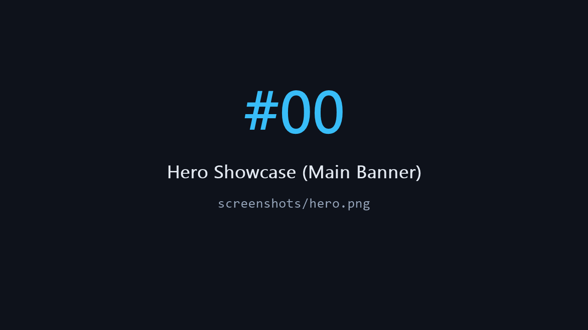

  <p align="center">
    <em>Pure transparent desktop immersion: softly dimmed wallpaper background, centered floating controls, and zero bulky borders.</em>
  </p>

</div>

<br />

---

## 💡 Why Bukaake?

Most photo viewers on Windows today are slow to launch, cluttered with heavy toolbars, or trap your pictures inside thick, distracting window frames. Some even force you to pay for extra codecs just to open photos from your iPhone.

**Bukaake** revives what made **Google Picasa Photo Viewer** so beloved, supercharged with modern Windows 10 & 11 design:

- 🪟 **Zero Distractions**: Truly borderless and translucent. Your desktop wallpaper stays softly dimmed in the background while your photo takes center stage.
- ⚡ **Instant Launch & Standby**: Opens in the blink of an eye (~5 MB single portable file) and trims idle tray memory down to ~8–15 MB RAM.
- 📷 **49+ Formats & Camera RAW**: Native iPhone HEIC/HEIF (100% free), 24+ RAW camera formats, and 3D VFX textures—zero external codecs needed.
- 🎨 **5-Tool Creative & Redaction Suite**: Blur/Pixelate (`U`), Smooth & Galaxy Pen (`D`), Vector Text (`T`), Laser-Guided Crop (`C`), and Real-Time Filters (`E`) with an on-screen Shortcut HUD.
- 📸 **Built-in Snip, OCR & GPU Record**: Capture regions, extract text with native Windows OCR, pick pixel colors, or record 60 FPS H.264 MP4 clips with <2% CPU overhead.
- 🗑️ **Stress-Free & Safe**: Send unwanted photos straight to your **Windows Recycle Bin** with `Delete`—easily restore them if you change your mind.

<br />

---

## ✨ Feature Showcase

### 1. 🪟 Picasa-Style Transparent Immersion

Open any picture and Bukaake softly dims your surrounding desktop wallpaper with zero blur artifacts, giving your photo center stage without boxing it inside an opaque window frame.

- **75% Viewport Ceiling**: Images comfortably fill up to 75% of your screen so your desktop stays visible.
- **Auto-Hiding Controls**: Move your mouse to reveal controls; stay idle for 2.5 seconds and all chrome fades smoothly away.
- **Elevated Control Dock**: Floating toolbars sit safely above your Windows taskbar.
- **1-Click Desktop Wallpaper**: Set any photo or edited canvas as your Windows wallpaper via native Win32 APIs with automatic PNG caching.

<p align="center">
  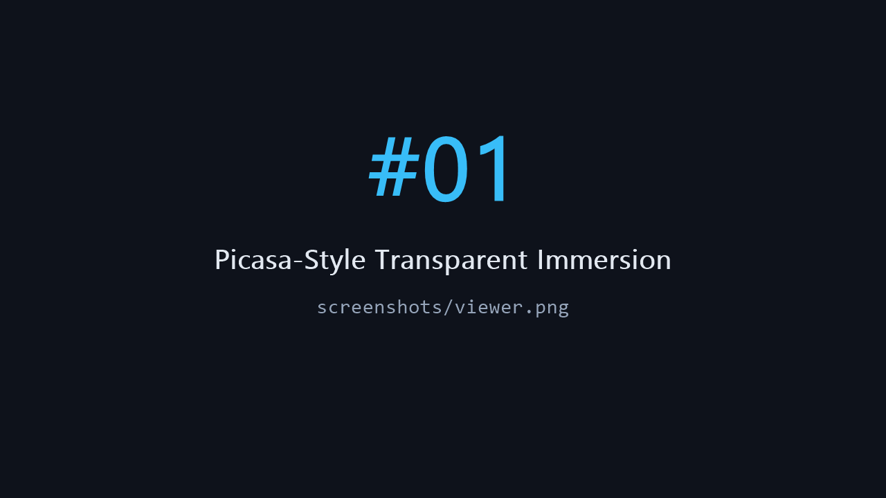
</p>

---

### 2. 📷 49+ Formats, Camera RAW & EXIF Telemetry

Bukaake natively opens **49 image formats** with zero external dependencies or paid extensions—from everyday WebP and Apple HEIC to full-sensor Camera RAW and 3D VFX textures.

- **Supported Formats**: `PNG`, `JPG`, `WebP`, `GIF`, `SVG`, `AVIF`, `HEIC`/`HEIF`, `ARW`, `CR2`, `CR3`, `NEF`, `DNG`, `RAF`, `RW2`, `ORF`, `EXR`, `HDR`, `DDS`, `TGA`, `QOI`, and more.
- **Instant Preview + Full Sensor Develop (`Q`)**: Opens embedded RAW previews in ~15ms, or press `Q` to unpack full uncompressed sensor data with an ambient titlebar progress beam.
- **EXIF Telemetry Drawer (`I`)**: Inspect camera body, lens, focal length, aperture, shutter speed, ISO, and GPS metadata.
- **5-Slot Predictive Prefetch**: Folder neighbors pre-load silently in the background for zero-latency arrow navigation.

<p align="center">
  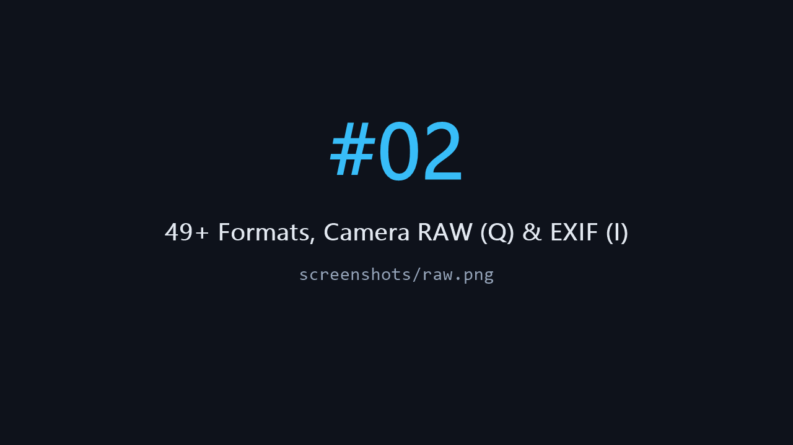
</p>

---

### 3. 📸 Screen Snipper, Native OCR & Loupe Eyedropper

Capture anything on your screen without launching heavy third-party tools.

- **Full Screen, Active Display, or Custom Region**: Multi-monitor crosshair capture with live dimension badges.
- **Native Screen OCR**: Extract text from any region using hardware-accelerated `Windows.Media.Ocr` while preserving line wraps and paragraphs, or send it straight to **[Cathet](https://github.com/Crlyzd/Cathet)**.
- **9×9 Loupe Color Eyedropper**: Magnify pixels to inspect and copy exact HEX and RGB color values in one click.
- **Instant Clipboard & Auto-Save**: Automatically copies snips (`CF_DIB`) and saves timestamped PNGs to `Pictures/Screenshots`.

<p align="center">
  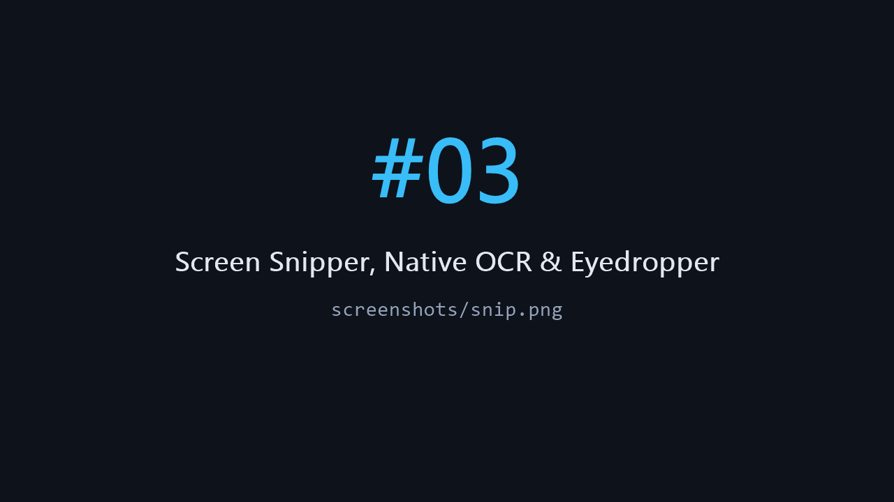
</p>

---

### 4. 🎥 Hardware GPU Screen Recorder

Record silky-smooth desktop or region videos directly to native `.mp4` files with minimal system impact.

- **Zero-Copy Direct3D 11 & WGC Pipeline**: Captures frames directly on the GPU (<2% CPU) and encodes hardware H.264/AAC via Windows Media Foundation.
- **Click Highlights & Tactile Audio**: Projects crisp halo ripples around mouse clicks with synthesized mechanical click audio and an optional cursor visibility toggle.
- **Sample-Accurate WASAPI Audio**: Mixes system loopback and microphone inputs at 48kHz stereo with ±200ms sync calibration and **Space Saver** 30 FPS mode (~75% smaller files).

<p align="center">
  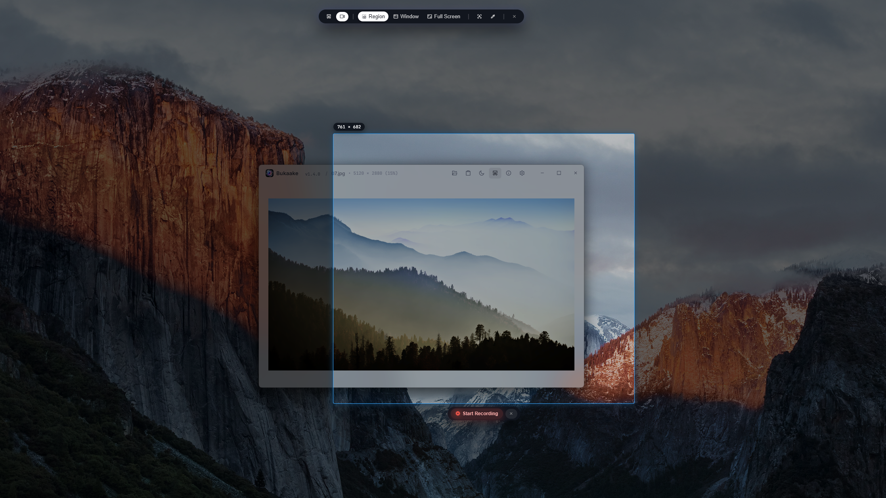
</p>

---

### 5. 🔒 Blur & Pixelate Redaction (`U`)

Hide sensitive details or softly blur backgrounds directly inside the viewer before sharing.

- **3 Masking Shapes**: Switch between freehand **Brush**, **Rectangle**, and **Circle** modes.
- **Non-Stacking Stroke Caching**: Overlapping brush strokes stay clean and uniform without muddy or double-darkened artifacts.
- **Customizable Intensity & Feathering**: Choose `Low`, `Med`, or `High` strength, toggle soft **Feather Edge** blending, and adjust brush size (`10px–150px`) with `[` / `]`.

<p align="center">
  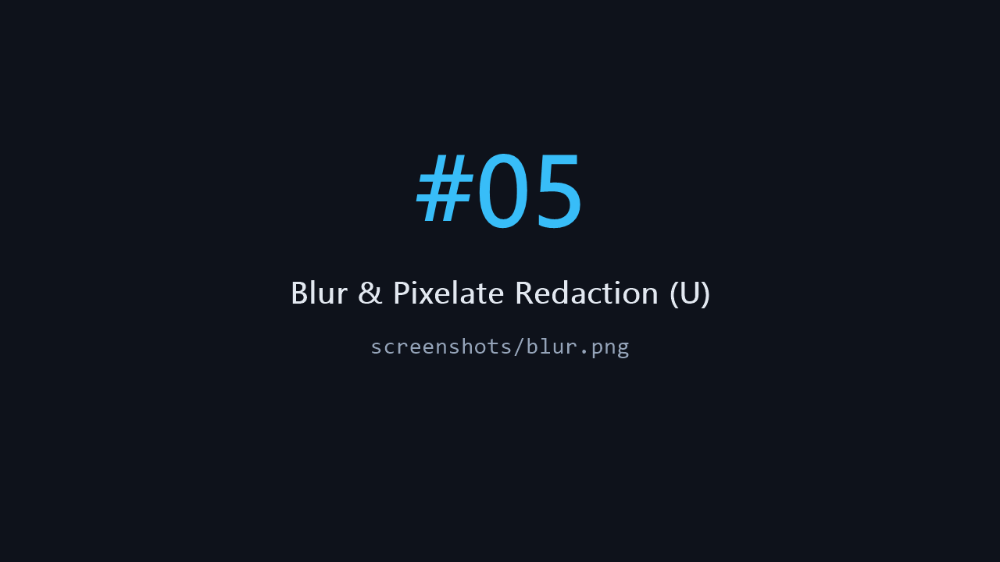
</p>

---

### 6. ✍️ Freehand Pen, Highlighter & Galaxy Auto-Smooth (`D` / `S`)

Sketch annotations, highlight details, or draw expressive calligraphic strokes right over your photos.

- **Tri-State Auto-Smooth (`S`)**: Cycle between **Off** (raw precision), **Natural** (clean curve smoothing), and **Galaxy Mode** (expressive tapered calligraphic ribbons with S-curve smoothing).
- **Straight-Line Axis Locks**: Hold `Shift` for horizontal lines or `Ctrl` for vertical lines when smoothing is off.
- **Full History**: Multi-step **Undo (`Ctrl+Z`)** and **Redo (`Ctrl+Y`)**, plus `[` / `]` quick brush sizing.

<p align="center">
  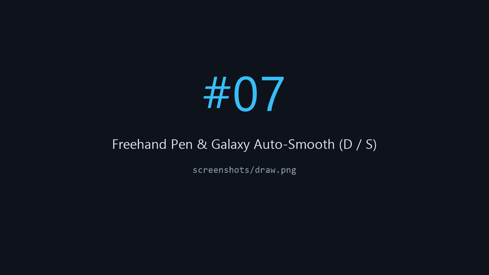
</p>

---

### 7. ✂️ Laser-Guided Crop (`C`)

Reframe photos effortlessly with precision snapping and instant aspect ratios.

- **Aspect Presets**: `1:1`, `16:9`, `9:16`, `4:3`, and `Freeform`.
- **Magnetic Laser Guides**: Snap crop edges and handles cleanly to image centers and borders.
- **Quick Commit**: Double-click inside the crop box or press `Enter` to apply immediately.

<p align="center">
  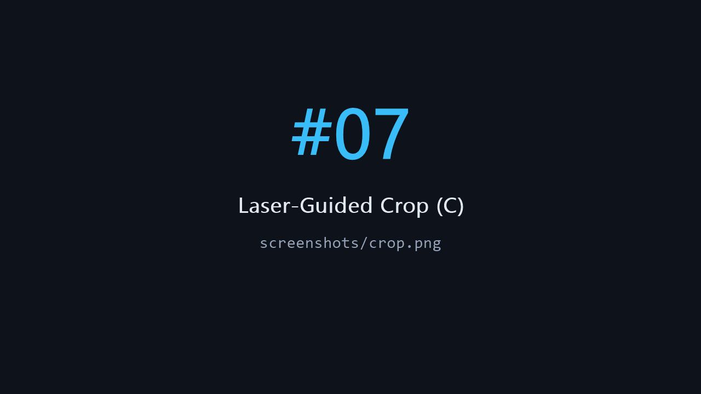
</p>

---

### 8. 🔤 Vector Typography (`T`)

Add crisp, scalable text captions and badges without opening an external editor.

- **Center-Anchored 8-Point Handles**: Resize and position text up to **600px** with scroll-wheel sizing and `Alt+T` or canvas double-click to spawn new boxes.
- **Shadows & Rounded Fills**: Unified popover for soft drop shadows, rounded background pills, and color palettes.
- **Magnetic Alignment**: Laser guides snap text boxes flush to center lines and edges.

<p align="center">
  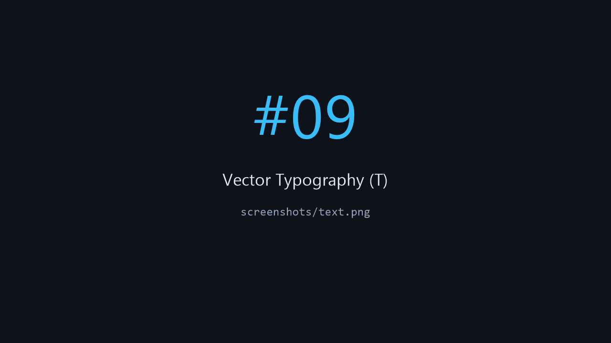
</p>

---

### 9. 🎛️ Real-Time Color Filters (`E`) & On-Screen Shortcut HUD

Fine-tune lighting and color at 60 FPS while keeping every tool shortcut within reach.

- **60 FPS Adjustments**: Real-time sliders for Brightness, Contrast, Saturation, Exposure, and Temperature, plus one-click transfer to **[Alitken](https://alitken.kaleksananbagus.com)** for advanced editing.
- **Collapsible Shortcut HUD**: Floating stroke-free cheat sheet for the active tool that tucks into a glowing corner beacon when minimized.
- **Smart Editing Window & Layered `Esc`**: Entering any tool in Mode 1 automatically expands the window (`1280×720`) for breathing room and restores your previous size on exit; pressing `Esc` closes popups first, then exits the tool without closing your photo.

<p align="center">
  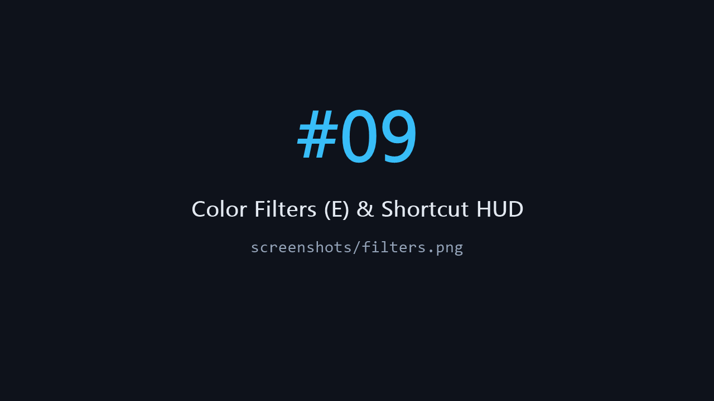
</p>

---

### 10. 🎨 Stroke-Free Dark & Light Themes

Designed from the ground up for modern Windows frosted-glass aesthetics with zero 1px border outlines.

- **Deep Obsidian Dark Mode**: True deep obsidian glass (`rgba(6, 7, 10, 0.92)`) with soft ambient shadows.
- **Soft Slate Light Mode**: Refined daytime palette using soft obsidian slate (`#242938`) with zero harsh pure-black borders.

<p align="center">
  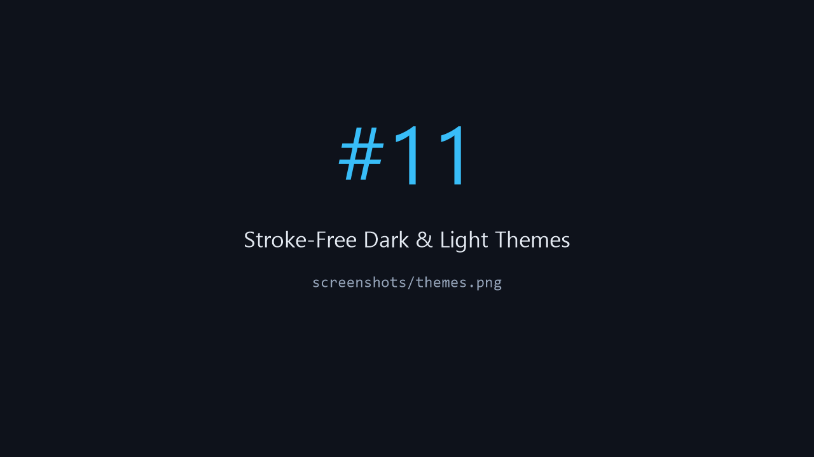
</p>

---

### 11. 🌐 Multi-Language & Portable Windows Integration

Built as a single ~5 MB standalone executable (or Microsoft Store MSIX) with zero external runtimes.

- **5 Built-In Languages**: Live hot-swapping across **English**, **Indonesian (Bahasa Indonesia)**, **Javanese Ngoko**, **Javanese Krama**, and **Javanese Malangan**—see **[CONTRIBUTING_TRANSLATIONS.md](CONTRIBUTING_TRANSLATIONS.md)** to add more.
- **1-Click HKCU File Associations**: Register 49 formats without UAC prompts; associations self-heal if you move `bukaake.exe` to another folder or USB drive.
- **In-Place Self-Updater**: Background GitHub Releases updates via `self-replace` (or automatic Windows Store updates for MSIX).

<p align="center">
  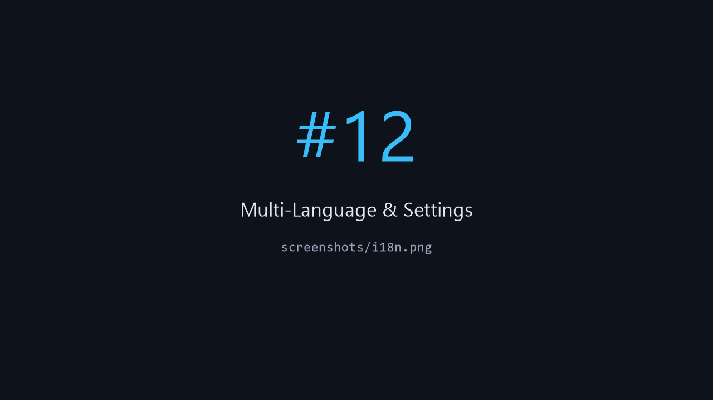
</p>

<br />

---

## ⌨️ Keyboard Shortcuts

<table width="100%">
<tr>
<th width="33%">🧭 Navigation & Zoom</th>
<th width="33%">🎨 Creative Tools</th>
<th width="33%">⚙️ Window & System</th>
</tr>
<tr>
<td valign="top">

| Key | Action |
| :--- | :--- |
| `Left` / `Right` | Previous / Next photo |
| `Up` / `Down` | Zoom In / Zoom Out (Picasa) |
| `Mouse Wheel` | Zoom anchored to cursor |
| `Middle Click` | Pan image canvas |
| `F` | Fit image to window |
| `1` | 100% actual size (1:1) |
| `,` / `.` (or `L`/`R`) | Rotate 90° Left / Right |
| `B` | Toggle background checkerboard |
| `P` | Toggle pixel art crisp mode |

</td>
<td valign="top">

| Key | Action |
| :--- | :--- |
| **`T`** | **Toggle Typography & Text Tool** |
| `D` | Toggle Pen & Highlighter |
| `U` | Toggle Blur & Pixelate Tool |
| `C` | Toggle Precision Crop |
| `E` | Toggle Color Adjustments |
| `S` | Cycle Drawing Auto-Smooth (Off / Natural / Galaxy) |
| `[` / `]` | Decrease / Increase Brush Size |
| `H` / `V` | Flip Horizontal / Vertical |
| `Q` | Full Sensor RAW Develop |
| `I` | Toggle EXIF Info Drawer |
| **`Enter`** | **Apply & commit active tool** |
| `Ctrl + Z` | Undo action / stroke |
| `Ctrl + Y` / `Ctrl+Shift+Z` | Redo action / stroke |

</td>
<td valign="top">

| Key | Action |
| :--- | :--- |
| `?` | Keyboard shortcuts cheat sheet |
| `Ctrl + O` | Open image file |
| `Ctrl + S` | Save / Export active image |
| `Ctrl + C` | Copy image to clipboard |
| `Ctrl + V` | Paste image from clipboard |
| `Alt+Shift+S` / `PrtScn` | Capture / Record Screen |
| `Delete` | Move to Recycle Bin (safe) |
| `Shift + Del` | Permanently delete |
| `F11` / `Enter` | Toggle Fullscreen Mode |
| `Esc` | Close popover / Exit tool / Standby |

</td>
</tr>
</table>

<br />

---

## 💻 System Requirements

| Component | Minimum Requirement | Recommended |
| :--- | :--- | :--- |
| **Operating System** | Windows 10 (64-bit, Version 19041+) | Windows 11 (64-bit, Version 22H2 or newer) |
| **Processor (CPU)** | Intel Core i3 / AMD Ryzen 3 / ARM64 | Intel Core i5 / AMD Ryzen 5 / Snapdragon X Elite |
| **Graphics (GPU)** | DirectX 11 capable GPU (Direct3D 11 & WGC) | Dedicated GPU or modern integrated graphics |
| **System Memory (RAM)** | 512 MB (~8–15 MB background standby) | 2 GB+ (for high-resolution Camera RAW sequences) |
| **Storage / Runtime** | ~10 MB free disk space | Single standalone portable `.exe` (~5 MB) |
| **Dependencies** | None. Zero external codecs, DLLs, or runtimes required. |

<br />

---

## 🚀 Quick Start

### 🏪 Option A: Microsoft Store (MSIX)
Install directly from the **[Microsoft Store](https://apps.microsoft.com/detail/9N964R72X9JS)** *(Listing ID: `9N964R72X9JS`)* for seamless automatic background updates, sandboxed reliability, and declarative Windows default app handling.

### ⚡ Option B: Standalone Portable Binary (~5 MB)
1. Download the latest binary from the **[Releases Page](https://github.com/Crlyzd/Bukaake/releases/latest)**:
   - For standard 64-bit PCs: `bukaake-vX.Y.Z-x64.exe`
   - For ARM devices (Surface Pro, Snapdragon X): `bukaake-vX.Y.Z-arm64.exe`
2. **Run the file directly.** No installer, no registry bloat, no administrative privileges required.
3. Click the **Settings** (gear icon) in the toolbar and select **Register Associations** to set Bukaake as your default viewer.

<br />

---

## 🛠️ Building From Source

Prerequisites: **Node.js 18+**, **Rust (stable)**, and the **C++ Build Tools for Windows**.

```powershell
# 1. Clone the repository
git clone https://github.com/Crlyzd/Bukaake.git
cd Bukaake

# 2. Install frontend dependencies
npm install

# 3. Launch with interactive Control Center
.\run.ps1
# or run with standard dev command:
npm run tauri:dev
```

<details>
<summary><b>View Developer Scripts & Build Commands</b></summary>

<br />

- `npm run dev` — Run local Vite dev server on `http://localhost:3000`.
- `npm run tauri:dev` — Launch Tauri v2 desktop application with live reload.
- `npm run build` — Production bundle validation for frontend assets.
- `cargo check --manifest-path src-tauri/Cargo.toml` — Fast backend type-check.
- `npm run bump` — Atomically synchronize versions across `package.json`, `Cargo.toml`, and `tauri.conf.json`.
- `.\run.ps1` (Option `[7]`) — Interactive Microsoft Store MSIX packaging and multi-architecture bundling.
- `powershell scripts/package-msix.ps1` — Automated MSIX Desktop Bridge staging, manifest templating, and bundle packaging.
- `powershell scripts/generate-store-assets.ps1` — Synthesize high-DPI Windows Store visual assets from `icon.png`.

</details>

<br />

---

## 💖 About the Creator & Support

Bukaake is designed and developed with ❤️ by **[Kaleksanan Bagus](https://kaleksananbagus.com)**.

If you love using Bukaake and want to support independent, high-performance desktop software:

<p>
  <a href="https://saweria.co/curlyzed" target="_blank"></a>
  <a href="https://ko-fi.com/curlyzed" target="_blank"></a>
</p>

- 🌐 **Official Website**: [bukaake.kaleksananbagus.com](https://bukaake.kaleksananbagus.com)
- 🌐 **Creator Portfolio**: [kaleksananbagus.com](https://kaleksananbagus.com)
- 🎨 **Companion Editor**: [alitken.kaleksananbagus.com](https://alitken.kaleksananbagus.com)
- 🐛 **Report a Bug or Suggest a Feature**: [Feedback Form](https://docs.google.com/forms/d/e/1FAIpQLSciTFA6rWYPq98UwqOvJgLnqGh5P71Vcz5d2GPVdne9Tz34WA/viewform) or open an [Issue](https://github.com/Crlyzd/Bukaake/issues).

<br />

---

## 🙏 Acknowledgements & Open-Source Credits

Bukaake is built on top of an incredible ecosystem of open-source projects, high-performance libraries, and Windows platform technologies:

### ⚡ Core Engine & Runtime
- **[Tauri v2](https://github.com/tauri-apps/tauri)** — Next-generation, memory-efficient desktop application framework.
- **[windows-rs](https://github.com/microsoft/windows-rs)** — Native Microsoft Win32 and WinRT bindings for Direct3D 11, WGC, OCR, and Media Foundation.
- **[window-vibrancy](https://github.com/tauri-apps/window-vibrancy)** — Native Windows Acrylic composition effects.
- **[self-replace](https://github.com/mitsuhiko/self-replace)** — Safe in-place binary executable replacement for self-updating.
- **[rfd](https://github.com/PolyMeilex/rfd)** — Native Rusty file dialogs.

### 📷 Imaging & Media Pipelines
- **[LibRaw](https://www.libraw.org/)** — Industry-standard camera RAW unpacking and Bayer demosaicing engine.
- **[image-rs](https://github.com/image-rs/image)** — Fast native image format encoding and decoding.
- **[heif-oxide](https://github.com/oxipng/heif-oxide)** — Pure Rust ISO/IEC 23008-12 ISOBMFF container parser for HEIC/HEIF photos.
- **[kamadak-exif](https://github.com/kamadak-exif/exif-rs)** — Comprehensive camera metadata and EXIF extraction.
- **[cpal](https://github.com/RustAudio/cpal)** — Cross-platform audio library powering WASAPI loopback and microphone capture.
- **[arboard](https://github.com/1Password/arboard)** — Native Win32 clipboard integration (`CF_DIB` / `CF_HDROP`).

### 🎨 Typography & Design System
- **[Inter](https://rsms.me/inter/)** by Rasmus Andersson — Modern, crisp user interface typography.
- **[JetBrains Mono](https://www.jetbrains.com/lp/mono/)** by JetBrains — High-contrast monospace font for camera specs and EXIF telemetry.
- **[Remix Icon](https://remixicon.com/)** by Remix Design — Minimalist, neutral monochrome SVG iconography.

<br />

---

<p align="center">
  Released under the <strong>GPL-3.0 License</strong>.
</p>
